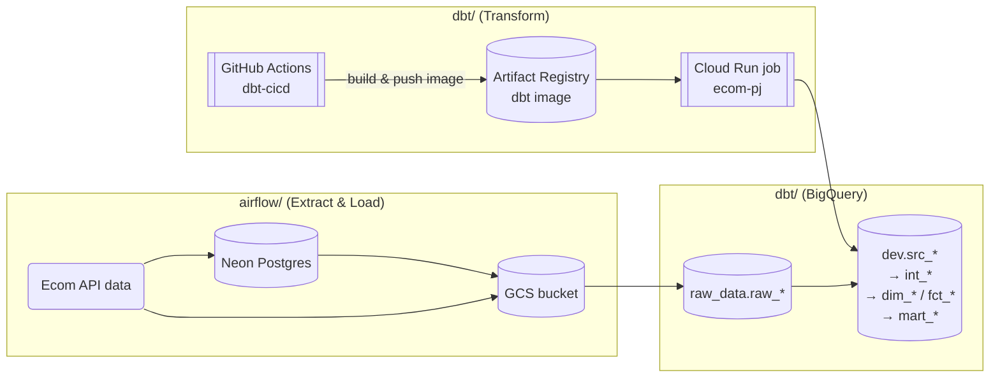
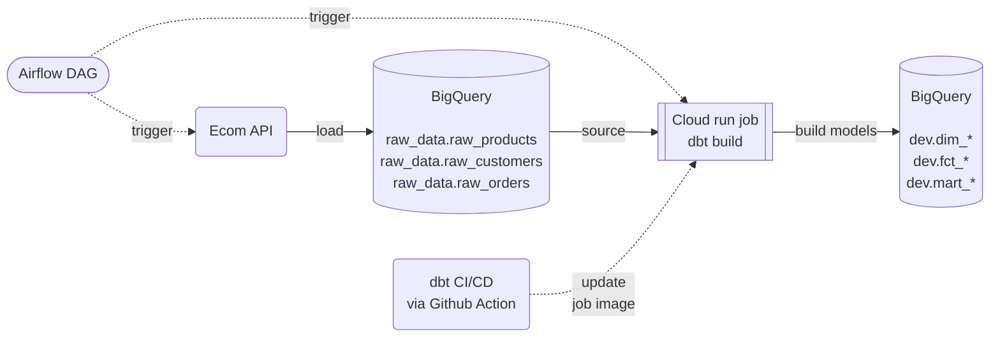
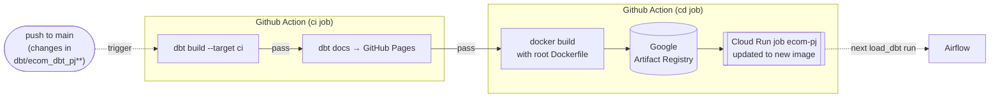

# Faker E-commerce Project — Airflow + dbt

An end-to-end ELT pipeline for a fake e-commerce data. 

**Airflow** loads raw products, customers and orders data into **BigQuery**. **dbt** then turns the raw data into dimension tables, fact tables and reporting marts.

| Folder | Role | Runs on | Details |
|---|---|---|---|
| [`airflow/`](airflow/) | **Extract & Load**: pulls data, checks it, lands it in GCS and BigQuery, and starts dbt | **Docker Compose**<br>(Airflow 3, `LocalExecutor`) | 👉 [airflow/README.md](airflow/README.md) |
| [`dbt/`](dbt/) | **Transform**: builds BigQuery tables ( `src` → `int` → `dim` / `fct` → `mart` models), and runs tests and data-quality checks | **GitHub Actions** (CI/CD)<br>tests dbt, then builds the Docker image and deploys it to the Cloud Run job<br><br>**Cloud Run job**<br>(started by Airflow)| 👉 [dbt/README.md](dbt/README.md) |

**Stack:** Airflow · dbt (`dbt-bigquery`) · BigQuery · Google Cloud Storage · Cloud Run · Artifact Registry · Neon Postgres · GitHub Actions · uv · Docker

**dbt Docs (lineage graph):** [candychen00.github.io/faker-ecom-project__airflow_dbt](https://candychen00.github.io/faker-ecom-project__airflow_dbt/)

<br><br>

## Table of Contents

1. [Architecture overview](#architecture-overview)
2. [What each folder contains](#what-each-folder-contains)
3. [How Airflow and dbt work together](#how-airflow-and-dbt-work-together)
4. [BigQuery datasets](#bigquery-datasets)
5. [Repository layout](#repository-layout)
6. [Getting started](#getting-started)

<br><br>

## Architecture overview



> **GitHub Actions keeps the Cloud Run job up to date.** 
> 
> Every push to `dbt/ecom_dbt_pj` tests the dbt project, builds a new image and deploys it to the `ecom-pj` Google cloud run job, so Airflow always runs the latest dbt code.
>
> **Airflow loads the data, and dbt transforms it.** 
>
> Airflow's DAGs pull data from the Ecom API and load it into the BigQuery `raw_data` dataset. The `load_dbt` DAG then starts the Cloud Run job, which runs `dbt build` to read `raw_data` and write the modelled tables to the `dev` dataset.

<br><br>

## Root-level Folders and Files

### `airflow/` — ingestion and orchestration

- **DAGs** (`dags/`):
  - `load_products`: fetches the product catalogue from the API, stores it in Neon Postgres, then copies it to BigQuery.
  - `load_customers`: fetches customers from the API and appends them to BigQuery.
  - `load_orders`: generates random orders from existing customers and products.
  - `load_dbt`: starts the dbt Cloud Run job.
- **Plugins** (`plugins/`): shared helpers such as API calls and Pydantic schema checks.
- **Tests** (`pytests/`): pytest unit tests for the plugin helpers (API fetching and Pydantic schema validation).
- **Local setup**: `Dockerfile` and `docker-compose.yaml` to run Airflow locally.

➡️ See **[airflow/README.md](airflow/README.md)** for the full details on the Airflow setup.

<br>

### `dbt/` — transformation and data quality

- **dbt project** (`dbt/ecom_dbt_pj/`):
  - `models/`: the `src`, `intermediate`, `dim`, `fct`, `mart` and `data_quality` layers.
  - `macros/`: reusable daily and monthly aggregations used by the marts.
  - `snapshots/`: SCD history for `dim_customers` and `dim_products`.
  - Tests: generic tests, `dbt_expectations`, and unit tests.

➡️ See **[dbt/README.md](dbt/README.md)** for the full details on the dbt setup.

<br>

### Other Root-level files

| File | Purpose |
|---|---|
| [`.dockerignore`](.dockerignore)<br>[`.gitignore`](.gitignore) | Keeps secrets out of github and dbt image. |
| [`.github/workflows/dbt-ci.yml`](.github/workflows/dbt-ci.yml) | CI/CD for dbt: tests the models, publishes dbt Docs, then deploys a new image to the Cloud Run job. |
| [`Dockerfile`](Dockerfile) | Packages the `dbt/` folder into an image via Github Action CI/CD. Cloud Run runs this image. |

<br><br>

## How Airflow and dbt work together

Airflow and dbt never import each other's code. They are linked in two ways:

1. **Through BigQuery tables.** Airflow writes the tables that dbt reads, and the other way round.
2. **Through the Cloud Run job `ecom-pj`.** Airflow triggers Cloud run job, and GitHub Actions keeps its image up to date.

### 1. Runtime flow (data)




### 2. Deployment flow (code)



- A change under `dbt/` starts the workflow. It first runs `dbt build` against a temporary `ci` dataset, which is deleted afterwards.
- If CI passes, the workflow publishes the dbt Docs and builds a new Docker image from the root `Dockerfile`. It then points the Cloud Run job `ecom-pj` at that image.
- Airflow doesn't need a redeploy. The next `load_dbt` run uses the latest dbt code.

<br><br>

## BigQuery datasets

| Dataset | Written by | Contents |
|---|---|---|
| `raw_data` | Airflow | `raw_products` (overwrite), `raw_customers` (append), `raw_orders` (append) |
| `dev` | dbt (`--target dev`, via Cloud Run) | Modelled tables: `src_*`, `int_*`, `dim_*`, `fct_orders`, `mart_*`, `dq_*`, snapshots |
| `ci` | dbt (`--target ci`, via GitHub Actions) | Temporary copy used for CI testing; deleted after each run |

<br><br>

## Repository layout

```text
faker-ecom-project__airflow_dbt/
├── airflow/                    # Extract & Load + orchestration   → airflow/README.md
│   ├── dags/                   #   load_products, load_customers, load_orders, load_dbt
│   ├── plugins/                #   shared helpers & Pydantic schemas
│   ├── pytests/                #   unit tests
│   ├── Dockerfile
│   └── docker-compose.yaml
├── dbt/                        # Transform                        → dbt/README.md
│   ├── ecom_dbt_pj/            #   dbt project (models, macros, snapshots, tests)
│   ├── pyproject.toml
│   └── uv.lock
├── Dockerfile                  # dbt image for the Cloud Run job
├── .dockerignore
└── .github/workflows/
    └── dbt-ci.yml              # dbt CI (test + docs) and CD (image → Cloud Run)
```

<br><br>

## Getting started

Each side is set up on its own:

1. **dbt**: install with uv, configure `profiles.yml`, and run `dbt build` locally. Make sure the Cloud Run job `ecom-pj` exists.
   → [dbt/README.md › Running Locally](dbt/README.md#running-locally) and [CI/CD](dbt/README.md#cicd)
2. **Airflow**: add the GCP key and `.env`, run `docker compose up`, then trigger the DAGs in the first-run order.
   → [airflow/README.md › Local setup](airflow/README.md#local-setup)

**You'll need:**

- A GCP project with BigQuery, Cloud Storage, Cloud Run and Artifact Registry
- A service account key for that project
- A Neon Postgres database
- The Ecom fake-data API URL and key
- A Discord webhook for notifications
