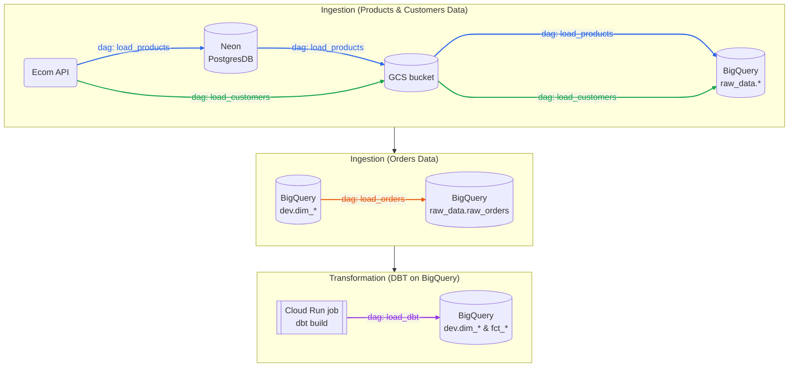
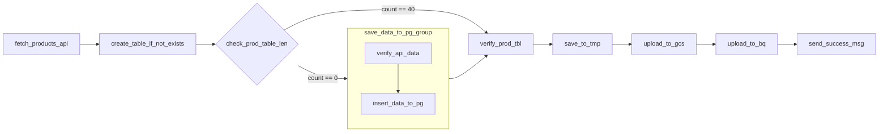
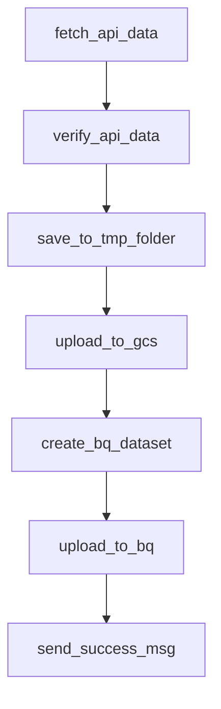
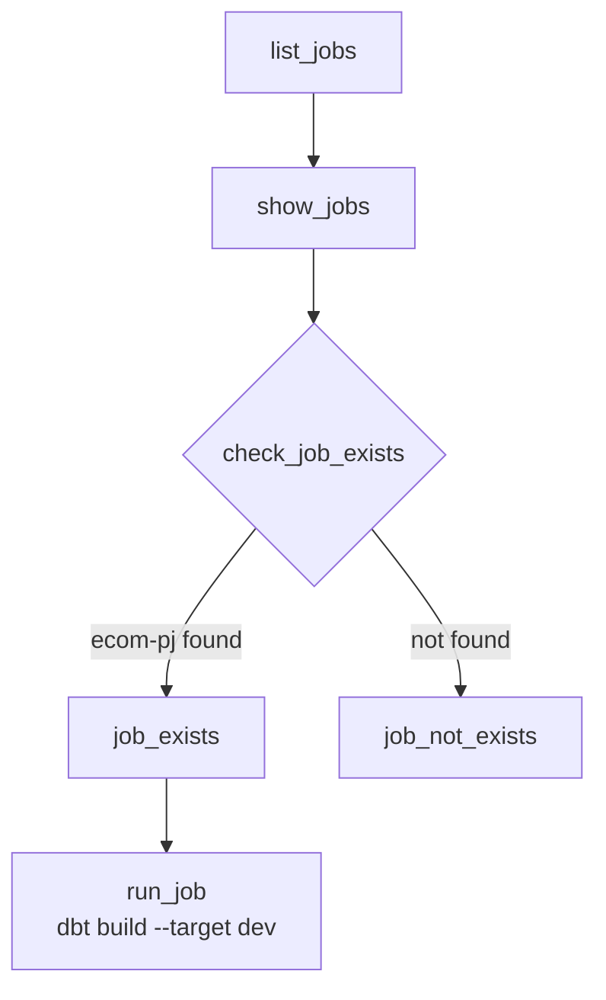
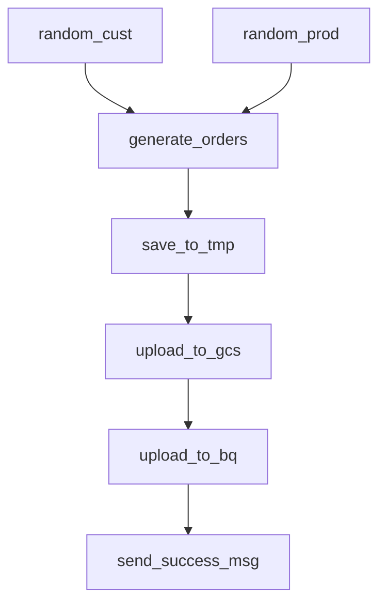

# Airflow — E-commerce Pipeline

- This folder holds the Airflow side of the project. The DAGs pull fake e-commerce data (products, customers, orders), check it, land it in **Google Cloud Storage**, load it into **BigQuery** (`raw_data` dataset), start the **dbt** transformations as a Cloud Run job.

- **Airflow version:3.3.2 (Python 3.12)**, runs in Docker Compose with `LocalExecutor`
- **Timezone used in DAG logic:** `Asia/Taipei`
- **Notifications:** Discord webhook after each successful load


<br><br>


## Table of Contents

1. [How the DAGs fit together](#how-the-dags-fit-together)
2. [DAG reference](#dag-reference)
   - [load_products](#1-load_products)
   - [load_customers](#2-load_customers)
   - [load_dbt](#3-load_dbt)
   - [load_orders](#4-load_orders)
3. [Folder structure](#folder-structure)
4. [Local setup](#local-setup)
5. [Running tests](#running-tests)
6. [Troubleshooting](#troubleshooting)


<br><br>

## How the DAGs fit together



| DAG | Schedule | Source | Destination |
|---|---|---|---|
| `load_products` | Manual | Ecom API → Neon Postgres | `raw_data.raw_products` (overwrite) |
| `load_customers` | `@daily` | Ecom API | `raw_data.raw_customers` (append) |
| `load_dbt` | Manual | — | Runs Cloud Run job `ecom-pj` (`dbt build --target dev`) |
| `load_orders` | `@daily` | BigQuery `dev.dim_customers` + `dev.dim_products` | `raw_data.raw_orders` (append) |

> **First-run order:** 
>
> `load_orders` builds orders from the dbt tables `dev.dim_customers` and `dev.dim_products`, so those tables must exist before it runs. On a fresh environment, run the DAGs in this order:
>
>    1. `load_products`
>    2. `load_customers`
>    3. `load_dbt` (for products and customers models)
>    4. `load_orders`

<br><br>

## DAG reference

### 1. `load_products`

**File:** [dags/load_products.py](dags/load_products.py) · **Schedule:** none (manual trigger)

Loads the fixed product catalogue (40 products) into Postgres and BigQuery. Postgres (Neon) is the source of truth for products. The DAG fills it once, checks it against an expected snapshot, and then copies it into BigQuery.



| Task | What it does |
|---|---|
| `fetch_products_api` | `GET {ECOM_API_URL}/products/generate_all_products` |
| `create_table_if_not_exists` | Creates the Postgres table `ecom_products` (`product_id`, `fruit`, `category`, `price NUMERIC(8,2)`) if it is missing |
| `check_prod_table_len` | **Branch.** Counts the rows in `ecom_products`. If there are 0 rows, it goes to the insert group. If there are 40 rows, it skips straight to verification. |
| `save_data_to_pg_group` → `verify_api_data` | Checks each product against the Pydantic `ProductBase` schema and splits them into valid and invalid lists |
| `save_data_to_pg_group` → `insert_data_to_pg` | Inserts the valid products into `ecom_products` |
| `verify_prod_tbl` | Reads `ecom_products` and uses `assert_frame_equal` to compare it with the expected data in [pytests/test_load_products/complete_prod_data.py](pytests/test_load_products/complete_prod_data.py). Uses trigger rule `none_failed_min_one_success`, so it runs after either branch. |
| `save_to_tmp` | Adds `created_at`/`updated_at` and writes `/tmp/products.parquet` with an explicit pyarrow schema. `price` is written as `decimal128(8,2)` so BigQuery reads it as `NUMERIC`. |
| `upload_to_gcs` | Uploads the file to `gs://<bucket>/products/products.parquet` |
| `upload_to_bq` | Loads the file into `raw_data.raw_products` with **`WRITE_TRUNCATE`**, which replaces the table on every run |
| `send_success_msg` | Posts a "Finished run" message to Discord |

> If the table holds any count other than 0 or 40, the branch picks no path and every later task is skipped.

---

### 2. `load_customers`

**File:** [dags/load_customers.py](dags/load_customers.py) · **Schedule:** `@daily` · **Start date:** 2026-10-01 (Asia/Taipei) · `catchup=False`

Fetches 20 new fake customers each day, checks them, and appends them to BigQuery.



| Task | What it does |
|---|---|
| `fetch_api_data` | `GET {ECOM_API_URL}/customers/fake_customers?num=20` |
| `verify_api_data` | Checks each customer against `CustomersBase`: UUID id, valid email, date `signup_date`, and a `name` of exactly two words |
| `save_to_tmp_folder` | Writes the valid customers to `/tmp/customers.parquet`. It casts `signup_date` to a date and adds `created_at`/`updated_at` without a timezone, so BigQuery reads them as `DATETIME`. If no customer is valid, it writes nothing. |
| `upload_to_gcs` | Uploads to `gs://<bucket>/customers/date=YYYY-MM-DD/customers_YYYYMMDDTHHMMSS.parquet` (partitioned by run date) |
| `create_bq_dataset` | Creates the `raw_data` dataset in `us-east1` if it does not exist yet (`exists_ok=True`) |
| `upload_to_bq` | Loads every parquet file in that day's folder into `raw_data.raw_customers` with `WRITE_APPEND` and an explicit schema |
| `send_success_msg` | Posts a Discord message |

---

### 3. `load_dbt`

**File:** [dags/load_dbt.py](dags/load_dbt.py) · **Schedule:** none (manual trigger)

Starts the dbt project, which runs as the Cloud Run job **`ecom-pj`**. That job's image is built and deployed by the GitHub Actions workflow in `.github/workflows/`. The DAG checks that the job exists first, then runs `dbt build --target dev`.



| Task | What it does |
|---|---|
| `list_jobs` | `CloudRunListJobsOperator`: lists the Cloud Run jobs in `GCP_PROJECT_ID` / `GCP_REGION` |
| `show_jobs` | Reduces each job's full resource name to its short name |
| `check_job_exists` | **Branch.** Goes to `job_exists` if `ecom-pj` is in the list, otherwise to `job_not_exists` |
| `job_exists` / `job_not_exists` | Log the result. The `job_not_exists` path ends the run there. |
| `run_job` | `CloudRunExecuteJobOperator`: runs `ecom-pj` with the container args overridden to `dbt build --target dev` (300 s timeout) |

---

### 4. `load_orders`

**File:** [dags/load_orders.py](dags/load_orders.py) · **Schedule:** `@daily` · **Start date:** 2026-08-01 (Asia/Taipei) · `catchup=False`

Makes 3–12 fake orders per day from customers and products that already exist, so every order points to a real customer and product.



| Task | What it does |
|---|---|
| `random_cust` | Picks 30 random rows from BigQuery `dev.dim_customers` (via [plugins/fn_fetch_random.py](plugins/fn_fetch_random.py)) |
| `random_prod` | Picks 30 random rows from BigQuery `dev.dim_products` |
| `generate_orders` | Creates 3–12 orders. Each order gets a UUID `order_id`, a random customer and product, a `quantity` from 1 to 20, and an `order_at` time set by Faker somewhere within the run's day (Asia/Taipei). |
| `save_to_tmp` | Writes `/tmp/orders.parquet` and converts `order_at` to a timestamp so BigQuery reads it as `DATETIME` |
| `upload_to_gcs` | Uploads to `gs://<bucket>/orders/date=YYYY-MM-DD/orders_YYYY-MM-DD.parquet` |
| `upload_to_bq` | Loads the file into `raw_data.raw_orders` with `WRITE_APPEND` (`CREATE_IF_NEEDED`) |
| `send_success_msg` | Posts a Discord message |

---

## Folder structure

```text
airflow/
├── dags/                          # Mounted into /opt/airflow/dags
│   ├── load_products.py           # Products: API → Postgres → GCS → BQ
│   ├── load_customers.py          # Customers: API → GCS → BQ (daily)
│   ├── load_orders.py             # Orders: generated from dim tables → GCS → BQ (daily)
│   ├── load_dbt.py                # Starts the dbt Cloud Run job
│   ├── data_generation/
│   │   └── load_gcs_to_bq.py      # Unfinished draft (no DAG defined yet)
│   └── tests/                     # Test DAGs (Discord, Neon, Postgres); gitignored
├── plugins/                       # Shared helpers, imported as `plugins.*`
│   ├── fn_api_get.py              # get_api_data(): GET request with error handling
│   ├── fn_api_verification.py     # verify_api(): Pydantic check → valid / invalid lists
│   ├── fn_fetch_random.py         # fetch_random_rows(): random sample from a BQ dev table
│   └── api_schemas/
│       ├── customers.py           # CustomersBase schema
│       └── products.py            # ProductBase schema
├── pytests/                       # pytest unit tests (mounted into the container)
│   ├── test_load_customers/
│   └── test_load_products/
│       └── complete_prod_data.py  # Expected product data, also used by load_products
├── config/
│   └── airflow.cfg                # Mounted as AIRFLOW_CONFIG
├── secret/
│   └── gcp-key.json               # GCP service account key (gitignored, mounted read-only)
├── logs/                          # Airflow task logs (gitignored)
├── .env                           # Environment variables & connections (gitignored)
├── Dockerfile                     # apache/airflow:3.3.2-python3.12 + requirements.txt
├── docker-compose.yaml            # Postgres metadata DB + Airflow services
├── requirements.txt               # Extra pip packages installed in the image
├── pyproject.toml / uv.lock       # Local (non-Docker) dev environment managed by uv
└── .python-version                # 3.12
```

The image sets `PYTHONPATH=/opt/airflow`, and `dags/`, `plugins/` and `pytests/` are mounted under `/opt/airflow`. This is why DAGs can use imports like `from plugins.fn_api_get import ...` and `from pytests.test_load_products... import ...`.

---

## Local setup

### Prerequisites

- Docker Desktop (Docker Compose v2), with at least 4 GB of memory available to Docker
- A GCP project containing:
  - a **GCS bucket**
  - **BigQuery** (datasets are created in `us-east1`)
  - a **service account** with access to Storage, BigQuery, and Cloud Run (Storage Object Admin, BigQuery Data Editor + Job User, Cloud Run Invoker/Developer), plus its JSON key
- A **Neon** (or any other) Postgres database for `ecom_products`
- The **Ecom fake-data API** URL and API key
- A **Discord webhook** URL (for notifications)
- Optional: [uv](https://docs.astral.sh/uv/), if you want a local virtualenv for IDE autocompletion

### 1. Clone and go to the folder

```bash
git clone <repo-url>
cd faker-ecom-project__airflow_dbt/airflow
```

### 2. Add the GCP service account key

```bash
mkdir -p secret
cp /path/to/your-service-account.json secret/gcp-key.json
```

Docker Compose mounts this file read-only at `/opt/airflow/secret/gcp-key.json`.

### 3. Create `.env`

Create `airflow/.env` with the variables below. **Never commit this file.**

```dotenv
# Airflow
AIRFLOW_UID=501                     # output of `id -u` (macOS/Linux)
AIRFLOW__CORE__FERNET_KEY=<generated key, see below>

# Ecom API
ECOM_API_URL=https://<your-api-host>
ECOM_API_KEY=<api key>

# Google Cloud
AIRFLOW_CONN_GOOGLE_CLOUD_DEFAULT='google-cloud-platform://?key_path=%2Fopt%2Fairflow%2Fsecret%2Fgcp-key.json&project=<gcp-project-id>'
GCP_PROJECT_ID=<gcp-project-id>
GCP_REGION=us-east1
GCP_CLOUD_STORAGE_BUCKET_NAME=<bucket-name>

# Neon Postgres
NEON_POSTGRES_URL=postgresql+psycopg2://<user>:<password>@<host>/<db>?sslmode=require

# Discord
AIRFLOW_CONN_DISCORD=<discord connection uri>
DISCORD_WEBHOOK=https://discord.com/api/webhooks/<id>/<token>
```

To generate a Fernet key:

```bash
python3 -c "from cryptography.fernet import Fernet; print(Fernet.generate_key().decode())"
```

The `AIRFLOW_CONN_*` variables define Airflow connections directly from the environment, so you don't need to create them in the UI. All DAGs use the GCP connection `google_cloud_default`.

### 4. Build the image and initialise Airflow

```bash
docker compose build
docker compose up airflow-init
```

`airflow-init` runs the metadata-DB migrations and creates the default admin user (**airflow / airflow**). To use different credentials, set `_AIRFLOW_WWW_USER_USERNAME` and `_AIRFLOW_WWW_USER_PASSWORD` in `.env`.

### 5. Start Airflow

```bash
docker compose up -d
docker compose ps        # wait until every service shows "healthy"
```

Open **http://localhost:8080** and log in.

### 6. Run the DAGs

New DAGs start **paused** (`DAGS_ARE_PAUSED_AT_CREATION=true`). Unpause them in the UI, or from the CLI:

```bash
docker compose run --rm airflow-cli dags unpause load_customers
docker compose run --rm airflow-cli dags trigger load_products
```

Follow the [first-run order](#how-the-dags-fit-together): `load_products` → `load_customers` → `load_dbt` → `load_orders`.

### 7. Stop / reset

```bash
docker compose down            # stop the containers
docker compose down -v         # also delete the Airflow metadata DB volume
```

### Optional: local virtualenv (for editor support)

```bash
uv sync --all-groups           # installs apache-airflow, pandas, pyarrow, etc. into .venv
```

This only gives your IDE imports and type hints. The DAGs themselves run inside Docker.

### Adding Python dependencies

Add the package to `requirements.txt`, then rebuild:

```bash
docker compose build && docker compose up -d
```

The Dockerfile installs packages with the official Airflow 3.3.2 constraints file, which keeps provider versions compatible.

---

## Running tests

The unit tests in `pytests/` cover the API helper and the Pydantic validation. Run them inside the Airflow container:

```bash
docker compose run --rm --entrypoint bash airflow-cli -c "cd /opt/airflow && pytest pytests -v"
```

---

## Troubleshooting

| Symptom | Likely cause |
|---|---|
| DAG missing from the UI | Import error. Check **Browse → DAG Import Errors**, or run `docker compose logs airflow-dag-processor`. |
| `load_products` skips every task after the branch | `ecom_products` holds a row count other than 0 or 40. Fix or truncate the table. |
| `verify_prod_tbl` fails with `AssertionError` | The Postgres products no longer match `complete_prod_data.py` |
| `load_orders` fails on `random_cust` / `random_prod` | The `dev.dim_*` tables don't exist yet. Run `load_dbt` first. |
| BigQuery load fails with a type mismatch | The parquet column types don't match `schema_fields`. Check the `datetime` and `decimal` casts in `save_to_tmp`. |
| Permission errors on `logs/` | `AIRFLOW_UID` in `.env` doesn't match your host user (`id -u`) |
